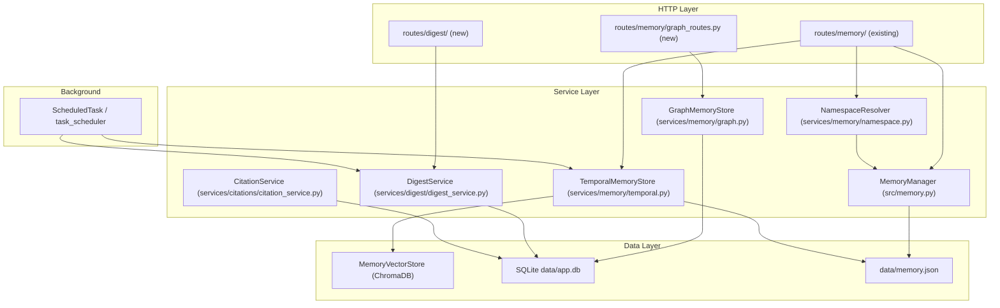

# Design Document — Phase 2: Knowledge & Memory

## Overview

Phase 2 adds five interconnected capabilities to the Odysseus memory system, all built
additively on top of the existing `MemoryManager` (flat-file JSON), `MemoryVectorStore`
(ChromaDB/fastembed), `CrewMember`/`Session` SQLAlchemy models, and `ScheduledTask`
infrastructure.

**Feature areas:**

| # | Feature | New artefacts |
|---|---------|---------------|
| 1 | Temporal memory (expiry, active_from, archival) | `services/memory/temporal.py`, DB columns |
| 2 | Graph memory (entity/relationship extraction + retrieval) | `services/memory/graph.py`, 2 new tables |
| 3 | Per-persona namespace isolation + promote | `services/memory/namespace.py`, column on memory entries |
| 4 | Auto-digest (nightly LLM journal) | `services/digest/digest_service.py`, `digests` table |
| 5 | Source citation tracking | `services/citations/citation_service.py`, frontend ES modules |

All database changes follow the Phase 1 pattern: additive `ALTER TABLE ADD COLUMN IF NOT EXISTS`
executed at application startup before `Base.metadata.create_all`.


---

## Architecture

### High-Level Component Diagram



### Integration Points with Existing Infrastructure

- **`MemoryManager`** — `temporal.py` and `namespace.py` wrap / delegate to `MemoryManager`.
  New fields (`expires_at`, `active_from`, `namespace`, `status`) are added to the flat-file
  JSON entries and read/written by the wrappers. Existing `load()` / `save()` / `add_entry()`
  signatures are unchanged.

- **`MemoryVectorStore`** — `temporal.py` calls `memory_vector.remove(id)` when archiving,
  ensuring archived entries drop out of semantic search automatically.

- **Chat pipeline** (`routes/chat_routes.py`) — after `ChatMessage` is persisted, an
  `asyncio.create_task` fires `GraphMemoryStore.schedule_extraction(message, owner)`. The task
  is fire-and-forget; exceptions are caught and logged.

- **Research pipeline** (`routes/research/research_routes.py`) — `CitationService` is called
  just before a research result is persisted. The service receives the sources list from the
  research handler and returns an annotated content string with a `## References` section.

- **Personal-docs RAG** — `CitationService.attach_rag_citations(chunks, answer)` is called
  in the RAG answer path to attach a `citations` list to the message metadata before
  `session_manager._persist_message` is called.


---

## Data Models

### 1. Memory Entry JSON (flat-file, `data/memory.json`)

Existing entries gain four nullable fields. No migration script is needed; the new code
reads them with `.get()` and defaults to `None`. On the next write the fields are
serialised alongside the existing ones.

```python
# Extended memory entry dict — new keys are italicised below
{
    "id": "uuid",
    "text": "...",
    "timestamp": 1700000000,     # int unix epoch (existing)
    "source": "user",            # existing
    "category": "fact",          # existing
    "owner": "alice",            # existing
    "session_id": "...",         # existing
    "uses": 3,                   # existing
    # -- Phase 2 additions --
    "expires_at": "2025-12-31T23:59:59Z",   # ISO-8601 UTC | null
    "active_from": "2025-01-01T00:00:00Z",  # ISO-8601 UTC | null
    "status": "active",          # "active" | "archived"
    "archived_at": None,         # ISO-8601 UTC set on archival | null
    "namespace": "global",       # "global" | crew_member_id string
}
```

### 2. New SQLite Tables

#### `graph_entities`

```sql
CREATE TABLE IF NOT EXISTS graph_entities (
    id            TEXT PRIMARY KEY,           -- UUID
    owner         TEXT NOT NULL,
    name          TEXT NOT NULL,              -- raw extracted name
    name_norm     TEXT NOT NULL,              -- lower().strip() for dedup
    type          TEXT NOT NULL,              -- person|project|concept|tool|organisation
    mention_count INTEGER NOT NULL DEFAULT 1,
    first_seen_at DATETIME NOT NULL,
    last_seen_at  DATETIME NOT NULL,
    UNIQUE (owner, name_norm, type)
);
CREATE INDEX IF NOT EXISTS ix_graph_entities_owner ON graph_entities(owner);
CREATE INDEX IF NOT EXISTS ix_graph_entities_search ON graph_entities(owner, name_norm);
```

#### `graph_relationships`

```sql
CREATE TABLE IF NOT EXISTS graph_relationships (
    id         TEXT PRIMARY KEY,              -- UUID
    owner      TEXT NOT NULL,
    source_id  TEXT NOT NULL REFERENCES graph_entities(id) ON DELETE CASCADE,
    target_id  TEXT NOT NULL REFERENCES graph_entities(id) ON DELETE CASCADE,
    type       TEXT NOT NULL,                 -- works-on|related-to|mentioned-with|…
    strength   INTEGER NOT NULL DEFAULT 1,
    created_at DATETIME NOT NULL,
    UNIQUE (owner, source_id, target_id, type)
);
CREATE INDEX IF NOT EXISTS ix_graph_rel_owner ON graph_relationships(owner);
CREATE INDEX IF NOT EXISTS ix_graph_rel_source ON graph_relationships(source_id);
CREATE INDEX IF NOT EXISTS ix_graph_rel_target ON graph_relationships(target_id);
```

#### `digests`

```sql
CREATE TABLE IF NOT EXISTS digests (
    id         TEXT PRIMARY KEY,             -- UUID
    owner      TEXT NOT NULL,
    date       TEXT NOT NULL,                -- ISO-8601 date "YYYY-MM-DD"
    status     TEXT NOT NULL DEFAULT 'pending', -- pending|complete|failed
    content    TEXT,                         -- structured JSON blob (nullable until complete)
    summary    TEXT,                         -- tone_summary plain text for quick display
    error      TEXT,                         -- error message if status=failed
    created_at DATETIME NOT NULL,
    updated_at DATETIME NOT NULL,
    UNIQUE (owner, date)
);
CREATE INDEX IF NOT EXISTS ix_digests_owner_date ON digests(owner, date DESC);
```

### 3. SQLAlchemy Models (added to `core/database.py`)

```python
class GraphEntity(Base):
    __tablename__ = "graph_entities"
    id            = Column(String, primary_key=True)
    owner         = Column(String, nullable=False, index=True)
    name          = Column(String, nullable=False)
    name_norm     = Column(String, nullable=False)
    type          = Column(String, nullable=False)
    mention_count = Column(Integer, nullable=False, default=1)
    first_seen_at = Column(DateTime, nullable=False)
    last_seen_at  = Column(DateTime, nullable=False)
    __table_args__ = (
        UniqueConstraint("owner", "name_norm", "type"),
        Index("ix_graph_entities_owner", "owner"),
        Index("ix_graph_entities_search", "owner", "name_norm"),
    )

class GraphRelationship(Base):
    __tablename__ = "graph_relationships"
    id         = Column(String, primary_key=True)
    owner      = Column(String, nullable=False, index=True)
    source_id  = Column(String, ForeignKey("graph_entities.id", ondelete="CASCADE"))
    target_id  = Column(String, ForeignKey("graph_entities.id", ondelete="CASCADE"))
    type       = Column(String, nullable=False)
    strength   = Column(Integer, nullable=False, default=1)
    created_at = Column(DateTime, nullable=False)
    __table_args__ = (
        UniqueConstraint("owner", "source_id", "target_id", "type"),
        Index("ix_graph_rel_owner", "owner"),
    )

class Digest(Base):
    __tablename__ = "digests"
    id         = Column(String, primary_key=True)
    owner      = Column(String, nullable=False, index=True)
    date       = Column(String, nullable=False)        # "YYYY-MM-DD"
    status     = Column(String, nullable=False, default="pending")
    content    = Column(Text, nullable=True)
    summary    = Column(Text, nullable=True)
    error      = Column(Text, nullable=True)
    created_at = Column(DateTime, nullable=False)
    updated_at = Column(DateTime, nullable=False)
    __table_args__ = (
        UniqueConstraint("owner", "date"),
        Index("ix_digests_owner_date", "owner", "date"),
    )
```

### 4. Migration Strategy

`core/database.py` already calls `Base.metadata.create_all(engine)` at startup, which
creates new tables. For new flat-file JSON fields, no migration is needed because existing
entries are read with `.get(field, None)` defaults.

```python
# core/database.py — added to the existing startup migration block
def _run_phase2_migrations(engine):
    """Idempotent additive migrations for Phase 2 tables."""
    with engine.connect() as conn:
        # Digests table is created by create_all; just ensure indexes exist.
        conn.execute(text(
            "CREATE INDEX IF NOT EXISTS ix_digests_owner_date "
            "ON digests(owner, date DESC)"
        ))
        conn.commit()
```


---

## Components and Interfaces

### `services/memory/temporal.py` — Temporal Memory Store

```python
from datetime import datetime, timezone
from typing import List, Optional, Dict
import logging
from src.memory import MemoryManager
from src.memory_vector import MemoryVectorStore

logger = logging.getLogger(__name__)

ISO_FMT = "%Y-%m-%dT%H:%M:%SZ"

def _parse_iso(value: str) -> datetime:
    """Parse an ISO-8601 UTC datetime string; raise ValueError on failure."""
    try:
        return datetime.strptime(value, ISO_FMT).replace(tzinfo=timezone.utc)
    except ValueError:
        raise ValueError(f"Invalid ISO-8601 UTC datetime: {value!r}")

def _utcnow() -> datetime:
    return datetime.now(timezone.utc)


class TemporalMemoryStore:
    def __init__(self, memory_manager: MemoryManager,
                 memory_vector: Optional[MemoryVectorStore] = None):
        self._mm = memory_manager
        self._mv = memory_vector

    # ----- Write helpers -----

    def validate_temporal_fields(self, expires_at: Optional[str],
                                  active_from: Optional[str]) -> None:
        """Raise ValueError (mapped to HTTP 422) if either field is invalid."""
        if expires_at is not None:
            _parse_iso(expires_at)
        if active_from is not None:
            _parse_iso(active_from)

    def set_temporal(self, entry: Dict, expires_at: Optional[str],
                     active_from: Optional[str]) -> Dict:
        """Attach temporal fields to an in-memory entry dict."""
        entry["expires_at"] = expires_at
        entry["active_from"] = active_from
        entry.setdefault("status", "active")
        return entry

    # ----- Read helpers -----

    def is_active(self, entry: Dict) -> bool:
        """Return True if the entry should appear in standard context retrieval."""
        if entry.get("status") == "archived":
            return False
        now = _utcnow()
        af = entry.get("active_from")
        if af:
            try:
                if _parse_iso(af) > now:
                    return False
            except ValueError:
                pass  # malformed stored value — treat as active
        return True

    def filter_active(self, entries: List[Dict]) -> List[Dict]:
        return [e for e in entries if self.is_active(e)]

    # ----- Time-range retrieval -----

    def time_range_query(
        self,
        entries: List[Dict],
        from_dt: Optional[str] = None,
        to_dt: Optional[str] = None,
        include_archived: bool = False,
    ) -> List[Dict]:
        """
        Return entries whose created_at (unix epoch) falls within [from_dt, to_dt].
        If from_dt > to_dt returns []. Partial bounds are supported.
        """
        from_ts: Optional[float] = None
        to_ts: Optional[float] = None
        if from_dt:
            from_ts = _parse_iso(from_dt).timestamp()
        if to_dt:
            to_ts = _parse_iso(to_dt).timestamp()
        if from_ts is not None and to_ts is not None and from_ts > to_ts:
            return []

        def _in_range(e: Dict) -> bool:
            if not include_archived and e.get("status") == "archived":
                return False
            ts = float(e.get("timestamp", 0))
            if from_ts is not None and ts < from_ts:
                return False
            if to_ts is not None and ts > to_ts:
                return False
            return True

        result = [e for e in entries if _in_range(e)]
        result.sort(key=lambda e: e.get("timestamp", 0))
        return result

    # ----- Archival -----

    def run_expiry_pass(self) -> int:
        """
        Scan all memory entries (all owners). Archive any where expires_at <= now.
        Returns the number of entries archived in this pass.
        """
        now = _utcnow()
        all_entries = self._mm.load_all()
        archived_count = 0
        changed = False
        for entry in all_entries:
            ea = entry.get("expires_at")
            if not ea or entry.get("status") == "archived":
                continue
            try:
                if _parse_iso(ea) <= now:
                    entry["status"] = "archived"
                    entry["archived_at"] = now.strftime(ISO_FMT)
                    archived_count += 1
                    changed = True
            except ValueError:
                logger.warning("Skipping malformed expires_at %r on entry %s",
                               ea, entry.get("id"))
        if changed:
            self._mm.save(all_entries)
            # Drop archived entries from vector index
            if self._mv and self._mv.healthy:
                for entry in all_entries:
                    if entry.get("status") == "archived":
                        self._mv.remove(entry["id"])
        logger.info("Expiry pass: archived %d entries", archived_count)
        return archived_count
```

### `services/memory/graph.py` — Graph Memory Store

```python
import asyncio
import json
import logging
import uuid
from datetime import datetime, timezone
from typing import Any, Dict, List, Optional, Tuple
from sqlalchemy.orm import Session as DBSession
from core.database import GraphEntity, GraphRelationship, SessionLocal
from src.llm_core import llm_call_async

logger = logging.getLogger(__name__)

VALID_ENTITY_TYPES = {"person", "project", "concept", "tool", "organisation"}
VALID_REL_TYPES = {
    "works-on", "related-to", "mentioned-with",
    "reports-to", "uses", "owns", "part-of"
}

_EXTRACTION_SYSTEM = """Extract entities and relationships from the text below.
Return ONLY a JSON object with two keys:
  "entities": [{"name": str, "type": "person|project|concept|tool|organisation"}, ...]
  "relationships": [{"source": str, "target": str, "type": "works-on|related-to|mentioned-with|reports-to|uses|owns|part-of"}, ...]
Use entity names exactly as they appear. If no entities, return empty lists."""

class GraphMemoryStore:
    def __init__(self, db_factory=None, llm_fn=None):
        self._db = db_factory or SessionLocal
        self._llm = llm_fn or llm_call_async

    # ----- Extraction -----

    def schedule_extraction(self, message: str, owner: str,
                             endpoint_url: str, model: str,
                             headers: Dict = None) -> None:
        """Fire-and-forget: schedule async LLM extraction for a chat message."""
        asyncio.create_task(
            self._extract_and_store(message, owner, endpoint_url, model, headers or {})
        )

    async def _extract_and_store(self, message: str, owner: str,
                                  endpoint_url: str, model: str,
                                  headers: Dict) -> None:
        try:
            raw = await asyncio.wait_for(
                self._llm(
                    endpoint_url, model,
                    [{"role": "system", "content": _EXTRACTION_SYSTEM},
                     {"role": "user", "content": message}],
                    temperature=0.0, max_tokens=800, headers=headers,
                ),
                timeout=30.0,
            )
            parsed = self._parse_extraction(raw)
        except Exception as exc:
            logger.warning("Graph extraction failed for owner=%s: %s", owner, exc)
            return

        db = self._db()
        try:
            entity_map = self._upsert_entities(db, owner, parsed.get("entities", []))
            self._upsert_relationships(db, owner, entity_map, parsed.get("relationships", []))
            db.commit()
        except Exception as exc:
            logger.error("Graph DB write failed: %s", exc)
            db.rollback()
        finally:
            db.close()

    def _parse_extraction(self, raw: str) -> Dict:
        """Parse LLM JSON output; return {"entities": [], "relationships": []} on error."""
        raw = raw.strip()
        if raw.startswith("```"):
            raw = raw.split("\n", 1)[-1].rsplit("```", 1)[0].strip()
        try:
            data = json.loads(raw)
        except json.JSONDecodeError:
            return {"entities": [], "relationships": []}
        # Validate types
        entities = []
        for e in data.get("entities") or []:
            name = str(e.get("name", "")).strip()
            etype = str(e.get("type", "")).lower()
            if name and etype in VALID_ENTITY_TYPES:
                entities.append({"name": name, "type": etype})
        relationships = []
        for r in data.get("relationships") or []:
            rtype = str(r.get("type", "")).lower()
            if rtype in VALID_REL_TYPES:
                relationships.append({
                    "source": str(r.get("source", "")).strip(),
                    "target": str(r.get("target", "")).strip(),
                    "type": rtype,
                })
        return {"entities": entities, "relationships": relationships}

    def _upsert_entities(self, db: DBSession, owner: str,
                          entities: List[Dict]) -> Dict[str, str]:
        """Upsert entities, return name->id map."""
        now = datetime.now(timezone.utc).replace(tzinfo=None)
        name_to_id: Dict[str, str] = {}
        for e in entities:
            name_norm = e["name"].lower().strip()
            row = (db.query(GraphEntity)
                   .filter_by(owner=owner, name_norm=name_norm, type=e["type"])
                   .first())
            if row:
                row.mention_count += 1
                row.last_seen_at = now
                name_to_id[e["name"]] = row.id
            else:
                eid = str(uuid.uuid4())
                row = GraphEntity(
                    id=eid, owner=owner,
                    name=e["name"], name_norm=name_norm, type=e["type"],
                    mention_count=1, first_seen_at=now, last_seen_at=now,
                )
                db.add(row)
                name_to_id[e["name"]] = eid
        return name_to_id

    def _upsert_relationships(self, db: DBSession, owner: str,
                               entity_map: Dict[str, str],
                               relationships: List[Dict]) -> None:
        """Upsert relationships, incrementing strength on duplicate."""
        now = datetime.now(timezone.utc).replace(tzinfo=None)
        for r in relationships:
            src_id = entity_map.get(r["source"])
            tgt_id = entity_map.get(r["target"])
            if not src_id or not tgt_id or src_id == tgt_id:
                continue
            row = (db.query(GraphRelationship)
                   .filter_by(owner=owner, source_id=src_id,
                               target_id=tgt_id, type=r["type"])
                   .first())
            if row:
                row.strength += 1
            else:
                db.add(GraphRelationship(
                    id=str(uuid.uuid4()), owner=owner,
                    source_id=src_id, target_id=tgt_id,
                    type=r["type"], strength=1, created_at=now,
                ))

    # ----- Retrieval -----

    def get_2hop_context(self, owner: str, query: str) -> str:
        """
        Find entities whose name appears in query, return a compact text
        summary of their 2-hop subgraph.
        """
        db = self._db()
        try:
            query_lower = query.lower()
            seed_ids = []
            for entity in db.query(GraphEntity).filter_by(owner=owner).all():
                if entity.name_norm in query_lower:
                    seed_ids.append(entity.id)
            if not seed_ids:
                return ""
            return self._build_context_text(db, owner, seed_ids, max_hops=2)
        finally:
            db.close()

    def _build_context_text(self, db: DBSession, owner: str,
                             seed_ids: List[str], max_hops: int = 2) -> str:
        visited = set(seed_ids)
        frontier = set(seed_ids)
        for _ in range(max_hops):
            next_frontier = set()
            for eid in frontier:
                for rel in (db.query(GraphRelationship)
                             .filter(GraphRelationship.owner == owner)
                             .filter(
                                 (GraphRelationship.source_id == eid) |
                                 (GraphRelationship.target_id == eid)
                             ).all()):
                    for nid in (rel.source_id, rel.target_id):
                        if nid not in visited:
                            visited.add(nid)
                            next_frontier.add(nid)
            frontier = next_frontier
        entities = (db.query(GraphEntity)
                    .filter(GraphEntity.id.in_(visited),
                            GraphEntity.owner == owner).all())
        if not entities:
            return ""
        lines = ["[Knowledge Graph Context]"]
        for e in entities:
            lines.append(f"- {e.name} ({e.type}, seen {e.mention_count}x)")
        return "\n".join(lines)

    def search_entities(self, owner: str, fragment: str) -> List[Dict]:
        db = self._db()
        try:
            q = db.query(GraphEntity).filter(GraphEntity.owner == owner)
            if fragment:
                q = q.filter(GraphEntity.name_norm.contains(fragment.lower()))
            return [self._entity_to_dict(e) for e in q.all()]
        finally:
            db.close()

    def get_entity_with_neighbours(self, owner: str, entity_id: str) -> Optional[Dict]:
        db = self._db()
        try:
            e = (db.query(GraphEntity)
                 .filter_by(id=entity_id, owner=owner).first())
            if not e:
                return None
            rels = (db.query(GraphRelationship)
                    .filter(GraphRelationship.owner == owner)
                    .filter(
                        (GraphRelationship.source_id == entity_id) |
                        (GraphRelationship.target_id == entity_id)
                    ).all())
            result = self._entity_to_dict(e)
            result["relationships"] = [
                {"source_id": r.source_id, "target_id": r.target_id,
                 "type": r.type, "strength": r.strength}
                for r in rels
            ]
            return result
        finally:
            db.close()

    def export_graph(self, owner: str) -> Dict:
        db = self._db()
        try:
            entities = (db.query(GraphEntity)
                        .filter_by(owner=owner).all())
            rels = (db.query(GraphRelationship)
                    .filter_by(owner=owner).all())
            return {
                "nodes": [self._entity_to_dict(e) for e in entities],
                "edges": [
                    {"source_id": r.source_id, "target_id": r.target_id,
                     "type": r.type, "strength": r.strength}
                    for r in rels
                ],
            }
        finally:
            db.close()

    @staticmethod
    def _entity_to_dict(e: GraphEntity) -> Dict:
        return {
            "id": e.id,
            "name": e.name,
            "type": e.type,
            "mention_count": e.mention_count,
            "first_seen_at": e.first_seen_at.isoformat() if e.first_seen_at else None,
            "last_seen_at": e.last_seen_at.isoformat() if e.last_seen_at else None,
        }
```


### `services/memory/namespace.py` — Namespace Resolver

```python
from typing import Optional, List, Dict
from src.memory import MemoryManager

GLOBAL_NS = "global"

class NamespaceResolver:
    def __init__(self, memory_manager: MemoryManager):
        self._mm = memory_manager

    def resolve_namespace(self, crew_member_id: Optional[str]) -> str:
        """Return the namespace for a write/read based on session context."""
        return crew_member_id if crew_member_id else GLOBAL_NS

    def write_entry(self, entry: Dict, crew_member_id: Optional[str]) -> Dict:
        """Tag an entry with the correct namespace before saving."""
        entry["namespace"] = self.resolve_namespace(crew_member_id)
        return entry

    def filter_for_session(self, entries: List[Dict],
                            owner: str,
                            crew_member_id: Optional[str]) -> List[Dict]:
        """
        Return entries visible in a given session context.
        - persona session: return namespace==crew_member_id OR namespace=="global"
        - global session: return namespace=="global" only
        All entries must already belong to `owner`.
        """
        ns = self.resolve_namespace(crew_member_id)
        if ns == GLOBAL_NS:
            return [e for e in entries
                    if e.get("owner") == owner and e.get("namespace") == GLOBAL_NS]
        return [e for e in entries
                if e.get("owner") == owner and
                (e.get("namespace") == ns or e.get("namespace") == GLOBAL_NS)]

    def promote_to_global(self, entry_id: str, owner: str) -> Dict:
        """
        Move entry to global namespace.
        Returns the updated entry dict.
        Raises KeyError if not found/not owned.
        Raises ValueError if already global.
        """
        all_entries = self._mm.load_all()
        target = next((e for e in all_entries
                        if e.get("id") == entry_id and e.get("owner") == owner), None)
        if target is None:
            raise KeyError(f"Memory entry {entry_id} not found")
        if target.get("namespace") == GLOBAL_NS:
            raise ValueError("Entry is already in global namespace")
        target["namespace"] = GLOBAL_NS
        self._mm.save(all_entries)
        return target
```

### `services/digest/digest_service.py` — Auto-Digest Service

```python
import json
import logging
import uuid
from datetime import datetime, date, timedelta, timezone
from typing import Optional, Dict, Any, List
from sqlalchemy.orm import Session as DBSession
from core.database import Digest, SessionLocal, ChatMessage as DBChatMessage
from src.llm_core import llm_call_async

logger = logging.getLogger(__name__)

_DIGEST_SYSTEM = """You are a personal assistant summarising the user's day.
Given a day's activity (chats, notes, emails), produce a JSON object with exactly these keys:
  "highlights": [str, ...]       -- key events or decisions (up to 8 items)
  "action_items": [str, ...]     -- follow-up tasks identified (up to 10 items)
  "open_questions": [str, ...]   -- unresolved questions or blockers
  "tone_summary": str            -- 1-3 sentence mood/productivity characterisation
Return ONLY valid JSON, no markdown fences."""

class DigestService:
    def __init__(self, db_factory=None, llm_fn=None):
        self._db = db_factory or SessionLocal
        self._llm = llm_fn or llm_call_async

    # ----- Collection -----

    def _collect_day(self, db: DBSession, owner: str,
                     target_date: date) -> str:
        """Build a plain-text string of the day's activity."""
        start = datetime(target_date.year, target_date.month, target_date.day, 0, 0, 0)
        end = start + timedelta(days=1)

        messages = (
            db.query(DBChatMessage)
            .join(DBChatMessage.session)
            .filter(
                DBChatMessage.session.has(owner=owner),
                DBChatMessage.timestamp >= start,
                DBChatMessage.timestamp < end,
                DBChatMessage.role.in_(["user", "assistant"]),
            )
            .order_by(DBChatMessage.timestamp)
            .all()
        )
        lines = []
        for m in messages:
            lines.append(f"[{m.role.upper()}] {(m.content or '')[:500]}")
        return "\n".join(lines) if lines else "(no activity)"

    # ----- Generation -----

    async def generate(
        self, owner: str,
        target_date: Optional[date] = None,
        endpoint_url: str = "",
        model: str = "",
        headers: Optional[Dict] = None,
    ) -> Dict[str, Any]:
        """Generate and persist a digest for owner on target_date (default: yesterday)."""
        if target_date is None:
            target_date = (datetime.now(timezone.utc) - timedelta(days=1)).date()
        date_str = target_date.isoformat()
        now = datetime.now(timezone.utc).replace(tzinfo=None)

        db = self._db()
        try:
            existing = (db.query(Digest)
                        .filter_by(owner=owner, date=date_str).first())
            if existing:
                digest_id = existing.id
                existing.status = "pending"
                existing.updated_at = now
            else:
                digest_id = str(uuid.uuid4())
                existing = Digest(
                    id=digest_id, owner=owner, date=date_str,
                    status="pending", created_at=now, updated_at=now,
                )
                db.add(existing)
            db.commit()

            activity_text = self._collect_day(db, owner, target_date)
        finally:
            db.close()

        # LLM call outside DB session
        try:
            raw = await llm_call_async(
                endpoint_url, model,
                [{"role": "system", "content": _DIGEST_SYSTEM},
                 {"role": "user", "content":
                  f"Date: {date_str}\n\n{activity_text}"}],
                temperature=0.3, max_tokens=1200, headers=headers or {},
            )
            raw = raw.strip()
            if raw.startswith("```"):
                raw = raw.split("\n", 1)[-1].rsplit("```", 1)[0].strip()
            parsed: Dict = json.loads(raw)
            # Normalise required keys
            for key in ("highlights", "action_items", "open_questions", "tone_summary"):
                if key not in parsed:
                    parsed[key] = [] if key != "tone_summary" else ""
        except Exception as exc:
            db2 = self._db()
            try:
                row = db2.query(Digest).filter_by(id=digest_id).first()
                if row:
                    row.status = "failed"
                    row.error = str(exc)
                    row.updated_at = datetime.now(timezone.utc).replace(tzinfo=None)
                    db2.commit()
            finally:
                db2.close()
            logger.error("Digest LLM call failed for %s/%s: %s", owner, date_str, exc)
            return {"status": "failed", "error": str(exc)}

        db3 = self._db()
        try:
            row = db3.query(Digest).filter_by(id=digest_id).first()
            if row:
                row.content = json.dumps(parsed, ensure_ascii=False)
                row.summary = parsed.get("tone_summary", "")
                row.status = "complete"
                row.updated_at = datetime.now(timezone.utc).replace(tzinfo=None)
                db3.commit()
        finally:
            db3.close()

        return {"status": "complete", "date": date_str, "content": parsed}

    # ----- Retrieval -----

    def list_digests(self, owner: str, limit: int = 30,
                     offset: int = 0) -> List[Dict]:
        db = self._db()
        try:
            rows = (db.query(Digest)
                    .filter_by(owner=owner)
                    .order_by(Digest.date.desc())
                    .offset(offset).limit(limit).all())
            return [self._digest_to_dict(r) for r in rows]
        finally:
            db.close()

    def get_by_date(self, owner: str, date_str: str) -> Optional[Dict]:
        db = self._db()
        try:
            row = db.query(Digest).filter_by(owner=owner, date=date_str).first()
            return self._digest_to_dict(row) if row else None
        finally:
            db.close()

    def search(self, owner: str, q: str) -> List[Dict]:
        q_lower = q.lower()
        db = self._db()
        try:
            rows = (db.query(Digest)
                    .filter(Digest.owner == owner)
                    .order_by(Digest.date.desc()).all())
            results = []
            for r in rows:
                if (q_lower in (r.content or "").lower() or
                        q_lower in (r.summary or "").lower()):
                    results.append(self._digest_to_dict(r))
            return results
        finally:
            db.close()

    @staticmethod
    def _digest_to_dict(r: Digest) -> Dict:
        content = None
        if r.content:
            try:
                content = json.loads(r.content)
            except json.JSONDecodeError:
                content = r.content
        return {
            "id": r.id,
            "date": r.date,
            "status": r.status,
            "summary": r.summary,
            "content": content,
            "error": r.error,
            "created_at": r.created_at.isoformat() if r.created_at else None,
        }
```


### `services/citations/citation_service.py` — Citation Service

```python
import json
import logging
from typing import Any, Dict, List, Optional

logger = logging.getLogger(__name__)

MAX_SNIPPET_LEN = 300

def _normalise_score(score: float) -> float:
    """Clamp ChromaDB 1-distance score to [0.0, 1.0]."""
    return max(0.0, min(1.0, float(score)))

def _dedup_citations(citations: List[Dict]) -> List[Dict]:
    """Keep only the highest-confidence citation per chunk_id / source_url."""
    seen: Dict[str, Dict] = {}
    for c in citations:
        key = c.get("chunk_id") or c.get("source_url") or id(c)
        key = str(key)
        if key not in seen or c["confidence_score"] > seen[key]["confidence_score"]:
            seen[key] = c
    return list(seen.values())

class CitationService:
    def build_rag_citations(
        self,
        retrieval_results: List[Dict],  # [{id, document, metadata, distance}, ...]
    ) -> List[Dict]:
        """
        Build a deduplicated citation list from vector retrieval results.
        Each entry: {chunk_id, source_url, source_title, snippet, confidence_score}
        """
        citations = []
        for hit in retrieval_results:
            meta = hit.get("metadata") or {}
            chunk_id = str(hit.get("id", ""))
            source_url = meta.get("source_url") or meta.get("url") or None
            source_title = meta.get("title") or meta.get("source_title") or "Unknown source"
            snippet = str(hit.get("document") or "")[:MAX_SNIPPET_LEN]
            distance = hit.get("distance", 0.0)
            confidence = _normalise_score(1.0 - float(distance))
            citations.append({
                "chunk_id": chunk_id,
                "source_url": source_url,       # may be null per Req 8.6
                "source_title": source_title,
                "snippet": snippet,
                "confidence_score": round(confidence, 4),
            })
        return _dedup_citations(citations)

    def attach_to_message_metadata(
        self,
        existing_metadata: Optional[str],
        citations: List[Dict],
    ) -> str:
        """
        Merge citations into a message metadata JSON string.
        Preserves all existing metadata fields.
        """
        meta: Dict[str, Any] = {}
        if existing_metadata:
            try:
                meta = json.loads(existing_metadata)
            except (json.JSONDecodeError, TypeError):
                pass
        meta["citations"] = citations
        return json.dumps(meta, ensure_ascii=False)

    def build_research_citations(
        self,
        sources: List[Dict],   # from research pipeline: [{url, title, content, ...}, ...]
    ) -> List[Dict]:
        """Build a deduplicated citation list from research sources."""
        citations = []
        for i, source in enumerate(sources):
            url = source.get("url") or None
            title = source.get("title") or "Unknown source"
            snippet = str(source.get("content") or source.get("snippet") or "")[:MAX_SNIPPET_LEN]
            # Research sources don't have cosine scores; use 1.0 as default
            confidence = float(source.get("confidence", 1.0))
            citations.append({
                "chunk_id": f"research-{i}",
                "source_url": url,
                "source_title": title,
                "snippet": snippet,
                "confidence_score": round(_normalise_score(confidence), 4),
            })
        return _dedup_citations(citations)

    def inject_references_section(
        self,
        report_content: str,
        citations: List[Dict],
    ) -> str:
        """
        Append a '## References' section to report_content.
        If citations is empty, return report_content unchanged (Req 10.4).
        """
        if not citations:
            return report_content
        lines = ["\n\n## References\n"]
        for i, c in enumerate(citations, start=1):
            url = c.get("source_url")
            title = c.get("source_title", "Unknown")
            snippet = c.get("snippet", "")
            if url:
                lines.append(f"[{i}] [{title}]({url})")
            else:
                lines.append(f"[{i}] {title}")
            if snippet:
                lines.append(f"    > {snippet[:200]}")
        return report_content + "\n".join(lines)
```


---

## API Endpoints

All new endpoints coexist with `routes/memory/memory_routes.py` — they are added
to separate router modules and registered in `app.py`.

### Memory — Temporal & Namespace additions (extend `routes/memory/memory_routes.py`)

| Method | Path | Description |
|--------|------|-------------|
| `GET` | `/api/memory/time-range` | Time-scoped retrieval (Req 2.5) |
| `POST` | `/api/memory/promote` | Promote entry to global namespace (Req 5.4) |

#### `GET /api/memory/time-range`
Query params: `from_dt` (ISO-8601), `to_dt` (ISO-8601), `include_archived=false`  
Auth: session cookie or Bearer token; owner-scoped  
Response: `{"entries": [...], "count": int}`

```python
@router.get("/time-range")
def memory_time_range(
    request: Request,
    from_dt: Optional[str] = Query(None),
    to_dt: Optional[str] = Query(None),
    include_archived: bool = Query(False),
):
    user = require_user(request)
    all_entries = memory_manager.load(owner=user)
    results = temporal_store.time_range_query(
        all_entries, from_dt=from_dt, to_dt=to_dt,
        include_archived=include_archived,
    )
    return {"entries": results, "count": len(results)}
```

#### `POST /api/memory/promote`
Body (JSON): `{"entry_id": str}`  
Response 200: `{"ok": true, "entry": {...}}`  
Response 404: entry not found / not owned  
Response 409: already global

```python
@router.post("/promote")
def promote_memory(request: Request, body: PromoteRequest):
    user = require_user(request)
    try:
        entry = ns_resolver.promote_to_global(body.entry_id, user)
    except KeyError:
        raise HTTPException(404, "Memory entry not found")
    except ValueError:
        raise HTTPException(409, "Entry is already in global namespace")
    return {"ok": True, "entry": entry}
```

### Graph Memory (`routes/memory/graph_routes.py`)

| Method | Path | Description |
|--------|------|-------------|
| `GET` | `/api/memory/graph/entities` | List/search entities (Req 4.3) |
| `GET` | `/api/memory/graph/entity/{entity_id}` | Single entity + neighbours (Req 4.4) |
| `GET` | `/api/memory/graph/export` | Full graph JSON for visualisation (Req 4.5) |

#### `GET /api/memory/graph/entities`
Query params: `q` (optional name fragment)  
Response: `{"entities": [{id, name, type, mention_count, first_seen_at, last_seen_at}, ...]}`

#### `GET /api/memory/graph/entity/{entity_id}`
Response 200: `{...entity fields..., "relationships": [{source_id, target_id, type, strength}]}`  
Response 404: not found or wrong owner

#### `GET /api/memory/graph/export`
Response: `{"nodes": [...], "edges": [{source_id, target_id, type, strength}]}`

### Digest (`routes/digest/digest_routes.py`)

| Method | Path | Description |
|--------|------|-------------|
| `POST` | `/api/digest/generate` | On-demand digest generation (Req 6.5) |
| `GET` | `/api/digest` | List digests, paginated (Req 6.6) |
| `GET` | `/api/digest/search` | Full-text search over digests (Req 7.1) |
| `GET` | `/api/digest/{date}` | Single digest by date (Req 6.7) |

#### `POST /api/digest/generate`
Body (JSON): `{"date": "YYYY-MM-DD"}` (optional, default yesterday)  
Response 202: `{"ok": true, "digest_id": str, "status": "pending"}`  
The actual generation runs in an `asyncio.create_task`.

#### `GET /api/digest`
Query: `limit=30&offset=0`  
Response: `{"digests": [...], "total": int}`

#### `GET /api/digest/search`
Query: `q=...`  
Response 200: `{"digests": [...], "count": int}`  
Response 400: `{"error": "q is required"}` on blank query

#### `GET /api/digest/{date}`
Response 200: full digest object  
Response 404: no digest for that date


---

## Key Algorithms

### 1. Namespace Resolution from `session.crew_member_id`

Namespace resolution happens at two points: write time (tagging the entry) and read time
(filtering the result set). The session row carries `crew_member_id` which is a direct
`CrewMember.id` value or `None`.

```
resolve_namespace(crew_member_id):
    if crew_member_id is None → "global"
    else → str(crew_member_id)

filter_for_read(entries, owner, crew_member_id):
    ns = resolve_namespace(crew_member_id)
    return [e for e in entries
            if e.owner == owner
            and (e.namespace == ns or e.namespace == "global")]
```

For backward compatibility, **existing entries that have no `namespace` field default to
`"global"`** during the filter: `e.get("namespace", "global")`.

### 2. LLM Entity Extraction + Deduplication

```
extraction_pass(message, owner, endpoint, model):
    prompt = EXTRACTION_SYSTEM + message
    raw_json = await llm_call(prompt, timeout=30s)
    parsed = parse_extraction(raw_json)      # validate types, trim invalid entries
    for entity in parsed.entities:
        name_norm = entity.name.lower().strip()
        existing = db.query(owner=owner, name_norm=name_norm, type=entity.type)
        if existing:
            existing.mention_count += 1
            existing.last_seen_at = now
        else:
            db.insert(GraphEntity(mention_count=1, first_seen_at=now, ...))
    for rel in parsed.relationships:
        src_id = entity_map[rel.source]
        tgt_id = entity_map[rel.target]
        existing = db.query(owner, src_id, tgt_id, type)
        if existing:
            existing.strength += 1
        else:
            db.insert(GraphRelationship(strength=1, ...))
```

Deduplication key is `(owner, name_norm, type)` with a `UNIQUE` constraint acting as
the final guard in SQLite. On conflict the application-level code already handles the
update path; if two concurrent tasks race on the same entity, the DB constraint prevents
double-insertion and the app retries via SQLAlchemy's `IntegrityError` handling.

### 3. 2-Hop Context Enrichment

```
get_2hop_context(owner, query_text):
    seeds = [entity for entity in all_entities(owner)
             if entity.name_norm in query_text.lower()]
    if not seeds: return ""
    visited = set(seed.id for seed in seeds)
    for hop in range(2):
        for eid in visited.copy():
            neighbours = direct_edges(eid)  # source_id==eid OR target_id==eid
            visited |= {n for n in neighbours if n not in visited}
    entities = db.query(id in visited, owner=owner)
    return compact_text(entities)   # "- Name (type, Nx)"
```

The compact text is prepended to the context payload under a `[Knowledge Graph Context]`
header to distinguish it from regular memory entries.

### 4. Citation Confidence Normalisation

ChromaDB returns *distances* in `[0, 2]` for cosine space (where 0 = identical and 2 =
opposite). The `MemoryVectorStore.search()` already converts to similarity via
`score = 1.0 - distance`. The `CitationService` receives this pre-converted score and
just clamps it:

```python
confidence = max(0.0, min(1.0, score))
```

For research sources that have no cosine score, `confidence = 1.0` is assigned
(trust sources fetched for research at face value; frontend will render them at full
confidence unless overridden).

### 5. Research Report `## References` Injection

```
inject_references_section(content, citations):
    if not citations: return content   # Req 10.4
    refs = []
    for i, c in enumerate(citations, 1):
        if c.source_url:
            refs.append(f"[{i}] [{c.source_title}]({c.source_url})")
        else:
            refs.append(f"[{i}] {c.source_title}")
        refs.append(f"    > {c.snippet[:200]}")
    return content + "\n\n## References\n" + "\n".join(refs)
```

Inline `[N]` markers in the report body are inserted by the research pipeline prompt —
the LLM is instructed to emit `[1]`, `[2]` markers wherever it draws a claim from a
source. The `## References` section is then injected deterministically by the service
rather than relying on the LLM to produce it.

### 6. Digest Collection Window

```
collect_day(owner, target_date):
    start = datetime(target_date.year, target_date.month, target_date.day, 0, 0, 0)
    end   = start + timedelta(days=1)
    messages = db.query(ChatMessage)
        .join(Session).filter(owner=owner)
        .filter(timestamp >= start AND timestamp < end)
        .filter(role IN ("user", "assistant"))
        .order_by(timestamp)
    return "\n".join(f"[{m.role.upper()}] {m.content[:500]}" for m in messages)
```

The window is midnight-to-midnight in the application server's local time (which is
typically set to the user's timezone via `TZ` environment variable or the `CrewMember.timezone`
field for future per-user scheduling). The default scheduled time is 02:00 local, well
after midnight, ensuring yesterday's data is complete.


---

## Frontend Architecture

All new frontend code follows the existing pattern: plain ES module `.js` files under
`static/js/`, imported with `<script type="module">` — no build step.

### New ES Modules

| File | Responsibility |
|------|---------------|
| `static/js/citations.js` | `CitationRenderer` class — parse citations, insert `<sup>` markers, expand panel |
| `static/js/memory-graph.js` | `MemoryGraphView` — fetch `/api/memory/graph/export`, render SVG force layout |
| `static/js/digest-panel.js` | `DigestPanel` — fetch and display digest list + detail modal |

### `citations.js` — Citation Renderer

```javascript
// static/js/citations.js

export class CitationRenderer {
    /**
     * @param {HTMLElement} messageEl - the rendered message container
     * @param {Array} citations - [{chunk_id, source_url, source_title, snippet, confidence_score}]
     */
    render(messageEl, citations) {
        if (!citations || citations.length === 0) return;
        // Build dedup map: chunk_id → citation index (1-based)
        const indexMap = new Map();
        citations.forEach((c, i) => {
            const key = c.chunk_id || c.source_url || i;
            if (!indexMap.has(key)) indexMap.set(key, i + 1);
        });
        // Walk text nodes and inject <sup> markers
        this._insertSupscripts(messageEl, citations, indexMap);
        // Append expandable reference list
        this._appendRefList(messageEl, citations);
    }

    _insertSupscripts(container, citations, indexMap) {
        // Find citation patterns like [1], [2] produced by LLM or injected by pipeline
        const walker = document.createTreeWalker(
            container, NodeFilter.SHOW_TEXT, null
        );
        const replacements = [];
        let node;
        while ((node = walker.nextNode())) {
            const match = node.textContent.match(/\[(\d+)\]/g);
            if (match) replacements.push({ node, match });
        }
        replacements.forEach(({ node }) => {
            const fragment = document.createDocumentFragment();
            const parts = node.textContent.split(/(\[\d+\])/);
            parts.forEach(part => {
                const m = part.match(/^\[(\d+)\]$/);
                if (m) {
                    const idx = parseInt(m[1], 10);
                    const citation = citations[idx - 1];
                    const sup = document.createElement("sup");
                    sup.className = "citation-marker";
                    if (citation && citation.confidence_score < 0.5) {
                        sup.classList.add("citation-low-confidence");
                    }
                    sup.dataset.citationIndex = idx;
                    sup.textContent = `[${idx}]`;
                    sup.title = citation ? citation.source_title : "";
                    sup.addEventListener("click", (e) => {
                        e.stopPropagation();
                        this._togglePanel(sup, citation);
                    });
                    fragment.appendChild(sup);
                } else {
                    fragment.appendChild(document.createTextNode(part));
                }
            });
            node.parentNode.replaceChild(fragment, node);
        });
    }

    _togglePanel(sup, citation) {
        const existing = sup.parentElement.querySelector(".citation-panel");
        if (existing) { existing.remove(); return; }
        const panel = document.createElement("div");
        panel.className = "citation-panel";
        const confidencePct = Math.round((citation.confidence_score || 0) * 100);
        let linkHtml = "";
        if (citation.source_url) {
            // source_url is always sanitised server-side; render as link
            linkHtml = `<a href="${escapeHtml(citation.source_url)}"
                           target="_blank" rel="noopener noreferrer">
                          ${escapeHtml(citation.source_title)}
                        </a>`;
        } else {
            // Req 9.5: null source_url → no anchor, no broken href
            linkHtml = `<span>${escapeHtml(citation.source_title)}</span>`;
        }
        panel.innerHTML = `
          <div class="citation-header">${linkHtml}
            <span class="citation-confidence">${confidencePct}%</span>
          </div>
          <blockquote class="citation-snippet">${escapeHtml(citation.snippet || "")}</blockquote>
        `;
        sup.insertAdjacentElement("afterend", panel);
    }

    _appendRefList(container, citations) {
        const list = document.createElement("ol");
        list.className = "citation-refs";
        citations.forEach((c, i) => {
            const li = document.createElement("li");
            if (c.source_url) {
                li.innerHTML = `<a href="${escapeHtml(c.source_url)}"
                                   target="_blank" rel="noopener noreferrer">
                                  ${escapeHtml(c.source_title)}
                                </a>`;
            } else {
                li.textContent = c.source_title;
            }
            list.appendChild(li);
        });
        container.appendChild(list);
    }

    /**
     * Restore citations on session restore (Req 9.4).
     * Called after message HTML is injected for a historical message.
     */
    restoreFromMetadata(messageEl, metadataJson) {
        let meta;
        try { meta = JSON.parse(metadataJson); } catch { return; }
        if (Array.isArray(meta.citations) && meta.citations.length > 0) {
            this.render(messageEl, meta.citations);
        }
    }
}

function escapeHtml(str) {
    return String(str || "")
        .replace(/&/g, "&amp;").replace(/</g, "&lt;")
        .replace(/>/g, "&gt;").replace(/"/g, "&quot;");
}
```

### `memory-graph.js` — Graph Visualisation

Reuses the SVG force-layout approach from the Phase 1 agent graph. Fetches
`GET /api/memory/graph/export` and renders a `<svg>` with:
- Nodes: circles coloured by entity type (person=blue, project=green, concept=orange, etc.)
- Edges: lines weighted by `strength`
- Hover tooltip showing `mention_count` and `first_seen_at`

```javascript
// static/js/memory-graph.js
export class MemoryGraphView {
    constructor(svgEl) { this.svg = svgEl; }

    async load(owner) {
        const res = await fetch("/api/memory/graph/export");
        const data = await res.json();
        this._render(data.nodes, data.edges);
    }

    _render(nodes, edges) {
        // Simple force-directed layout using the same SVG + requestAnimationFrame
        // pattern already used in agent_graph.js
        // ... (implementation mirrors existing agent graph renderer)
    }
}
```


---

## Correctness Properties

*A property is a characteristic or behavior that should hold true across all valid executions
of a system — essentially, a formal statement about what the system should do. Properties
serve as the bridge between human-readable specifications and machine-verifiable correctness
guarantees.*

### Property 1: Temporal fields round-trip

*For any* memory entry with valid `expires_at` and `active_from` ISO-8601 strings, writing
the entry via `TemporalMemoryStore.set_temporal` and reading it back via
`MemoryManager.load_all` should preserve both temporal fields exactly.

**Validates: Requirements 1.1, 1.2**

```python
# Hypothesis sketch
from hypothesis import given, strategies as st
from services.memory.temporal import TemporalMemoryStore, ISO_FMT
from datetime import datetime, timezone

iso_dt = st.datetimes(
    min_value=datetime(2000, 1, 1), max_value=datetime(2100, 1, 1),
    timezones=st.just(timezone.utc)
).map(lambda dt: dt.strftime(ISO_FMT))

@given(expires_at=iso_dt | st.none(), active_from=iso_dt | st.none())
def test_temporal_round_trip(expires_at, active_from, tmp_memory_manager):
    store = TemporalMemoryStore(tmp_memory_manager)
    store.validate_temporal_fields(expires_at, active_from)
    entry = tmp_memory_manager.add_entry("test text", owner="alice")
    store.set_temporal(entry, expires_at, active_from)
    all_entries = tmp_memory_manager.load_all()
    all_entries.append(entry)
    tmp_memory_manager.save(all_entries)
    loaded = next(e for e in tmp_memory_manager.load_all()
                  if e["id"] == entry["id"])
    assert loaded["expires_at"] == expires_at
    assert loaded["active_from"] == active_from
```

---

### Property 2: Active-from exclusion

*For any* memory entry with `active_from` set to a future UTC datetime,
`TemporalMemoryStore.filter_active` should exclude that entry from its output.

**Validates: Requirements 1.3**

```python
from hypothesis import given, strategies as st

@given(hours_ahead=st.integers(min_value=1, max_value=8760))
def test_future_active_from_excluded(hours_ahead, tmp_memory_manager):
    from datetime import timedelta, datetime, timezone
    future = (datetime.now(timezone.utc) + timedelta(hours=hours_ahead))
    future_str = future.strftime(ISO_FMT)
    store = TemporalMemoryStore(tmp_memory_manager)
    entry = {"id": "x1", "text": "hello", "active_from": future_str,
             "status": "active", "owner": "alice"}
    result = store.filter_active([entry])
    assert entry not in result
```

---

### Property 3: Expiry archival is complete across all owners

*For any* set of memory entries with `expires_at` in the past, belonging to any
combination of owners, after `TemporalMemoryStore.run_expiry_pass()` runs, every
entry with a past `expires_at` must have `status == "archived"`.

**Validates: Requirements 1.4, 1.5, 1.8**

```python
@given(st.lists(
    st.fixed_dictionaries({
        "id": st.uuids().map(str),
        "text": st.text(min_size=1),
        "owner": st.sampled_from(["alice", "bob", "carol"]),
        "expires_at": st.just("2000-01-01T00:00:00Z"),  # always in the past
        "status": st.just("active"),
        "timestamp": st.integers(min_value=0),
    }),
    min_size=1, max_size=30
))
def test_expiry_pass_archives_all(entries, tmp_memory_manager):
    tmp_memory_manager.save(entries)
    store = TemporalMemoryStore(tmp_memory_manager)
    archived = store.run_expiry_pass()
    all_after = tmp_memory_manager.load_all()
    for e in all_after:
        if e.get("expires_at") == "2000-01-01T00:00:00Z":
            assert e["status"] == "archived"
            assert e.get("archived_at") is not None
    assert archived == len(entries)
```

---

### Property 4: Archived entries excluded from standard retrieval

*For any* memory entry with `status == "archived"`, `TemporalMemoryStore.filter_active`
should never return it.

**Validates: Requirements 1.6**

```python
@given(st.lists(
    st.fixed_dictionaries({
        "id": st.uuids().map(str),
        "text": st.text(min_size=1),
        "status": st.just("archived"),
        "owner": st.just("alice"),
        "timestamp": st.integers(min_value=0),
    }),
    min_size=0, max_size=20
))
def test_archived_excluded(archived_entries, tmp_memory_manager):
    store = TemporalMemoryStore(tmp_memory_manager)
    result = store.filter_active(archived_entries)
    assert result == []
```

---

### Property 5: Time-range filter returns exactly the entries in range

*For any* set of memory entries with known timestamps and any `[from_dt, to_dt]` range,
`TemporalMemoryStore.time_range_query` returns exactly those active entries whose
`timestamp` falls within the range.

**Validates: Requirements 2.1, 2.2, 2.3, 2.4**

```python
from hypothesis import given, strategies as st
from datetime import datetime, timezone

@given(
    entries=st.lists(
        st.fixed_dictionaries({
            "id": st.uuids().map(str),
            "text": st.text(min_size=1),
            "owner": st.just("alice"),
            "status": st.just("active"),
            "timestamp": st.integers(min_value=0, max_value=int(2e9)),
        }), min_size=0, max_size=50
    ),
    from_ts=st.integers(min_value=0, max_value=int(2e9)) | st.none(),
    to_ts=st.integers(min_value=0, max_value=int(2e9)) | st.none(),
)
def test_time_range_filter(entries, from_ts, to_ts, tmp_memory_manager):
    from services.memory.temporal import TemporalMemoryStore, ISO_FMT
    store = TemporalMemoryStore(tmp_memory_manager)
    from_dt = datetime.fromtimestamp(from_ts, tz=timezone.utc).strftime(ISO_FMT) if from_ts else None
    to_dt = datetime.fromtimestamp(to_ts, tz=timezone.utc).strftime(ISO_FMT) if to_ts else None
    result = store.time_range_query(entries, from_dt=from_dt, to_dt=to_dt)
    result_ids = {e["id"] for e in result}
    for e in entries:
        in_range = True
        if from_ts is not None and e["timestamp"] < from_ts:
            in_range = False
        if to_ts is not None and e["timestamp"] > to_ts:
            in_range = False
        if from_ts is not None and to_ts is not None and from_ts > to_ts:
            in_range = False
        assert (e["id"] in result_ids) == in_range
```

---

### Property 6: Namespace isolation — persona reads only own + global entries

*For any* set of entries across multiple namespaces, `NamespaceResolver.filter_for_session`
for a given `crew_member_id` should return only entries with that namespace OR `"global"`,
never entries from other persona namespaces.

**Validates: Requirements 5.1, 5.2, 5.3, 5.7**

```python
@given(
    crew_id=st.text(min_size=1, max_size=36),
    other_id=st.text(min_size=1, max_size=36),
    entries=st.lists(
        st.fixed_dictionaries({
            "id": st.uuids().map(str),
            "text": st.text(min_size=1),
            "owner": st.just("alice"),
            "namespace": st.sampled_from(["global", "persona-a", "persona-b"]),
            "status": st.just("active"),
        }), min_size=0, max_size=40
    )
)
def test_namespace_isolation(crew_id, other_id, entries):
    assume(crew_id != other_id)
    from services.memory.namespace import NamespaceResolver
    from src.memory import MemoryManager
    resolver = NamespaceResolver(MemoryManager.__new__(MemoryManager))
    result = resolver.filter_for_session(entries, "alice", crew_id)
    for e in result:
        assert e["namespace"] in (crew_id, "global")
    # Entries from other namespace must not appear
    for e in entries:
        if e["namespace"] not in (crew_id, "global"):
            assert e not in result
```

---

### Property 7: Citation deduplication keeps maximum confidence

*For any* list of citations that may contain duplicates by `chunk_id`, the deduplicated
list should contain exactly one entry per unique `chunk_id`, and that entry should have
the maximum `confidence_score` of all duplicates.

**Validates: Requirements 8.4**

```python
@given(st.lists(
    st.fixed_dictionaries({
        "chunk_id": st.sampled_from(["c1", "c2", "c3"]),
        "source_url": st.none() | st.just("https://example.com"),
        "source_title": st.just("Test"),
        "snippet": st.just("..."),
        "confidence_score": st.floats(min_value=0.0, max_value=1.0,
                                       allow_nan=False),
    }), min_size=0, max_size=20
))
def test_citation_dedup_max_confidence(citations):
    from services.citations.citation_service import _dedup_citations
    result = _dedup_citations(citations)
    seen_keys = set()
    for c in result:
        key = c["chunk_id"]
        assert key not in seen_keys, "Duplicate chunk_id after dedup"
        seen_keys.add(key)
        # Verify this is the max confidence for this chunk_id
        max_conf = max(x["confidence_score"] for x in citations
                       if x["chunk_id"] == key)
        assert abs(c["confidence_score"] - max_conf) < 1e-9
```

---

### Property 8: Confidence score always in [0.0, 1.0]

*For any* cosine similarity value (a float), `_normalise_score` should return a value
in `[0.0, 1.0]`.

**Validates: Requirements 8.3**

```python
@given(st.floats(allow_nan=False, allow_infinity=False))
def test_confidence_normalisation(score):
    from services.citations.citation_service import _normalise_score
    result = _normalise_score(score)
    assert 0.0 <= result <= 1.0
```

---

### Property 9: References section injection is idempotent on content, present iff citations non-empty

*For any* report content string and non-empty citations list, `inject_references_section`
should produce output that contains a `## References` section. For an empty citations list
the output should equal the input unchanged.

**Validates: Requirements 10.1, 10.4**

```python
@given(
    content=st.text(),
    citations=st.lists(
        st.fixed_dictionaries({
            "chunk_id": st.uuids().map(str),
            "source_url": st.none() | st.just("https://example.com"),
            "source_title": st.text(min_size=1, max_size=50),
            "snippet": st.text(max_size=200),
            "confidence_score": st.just(1.0),
        }), min_size=0, max_size=10
    )
)
def test_references_section(content, citations):
    from services.citations.citation_service import CitationService
    cs = CitationService()
    result = cs.inject_references_section(content, citations)
    if citations:
        assert "## References" in result
    else:
        assert result == content
```

---

### Property 10: Entity extraction type validation

*For any* raw LLM extraction JSON string, `GraphMemoryStore._parse_extraction` should
return an object where every entity has a `type` drawn from the valid set and every
relationship has a `type` drawn from the valid relationship set.

**Validates: Requirements 3.2, 3.5**

```python
from hypothesis import given, strategies as st
import json

@given(st.lists(
    st.fixed_dictionaries({
        "name": st.text(min_size=1, max_size=50),
        "type": st.text(min_size=1, max_size=20),  # may include invalid types
    }), max_size=10
))
def test_entity_type_validation(raw_entities):
    from services.memory.graph import GraphMemoryStore, VALID_ENTITY_TYPES
    store = GraphMemoryStore.__new__(GraphMemoryStore)
    raw = json.dumps({"entities": raw_entities, "relationships": []})
    parsed = store._parse_extraction(raw)
    for e in parsed["entities"]:
        assert e["type"] in VALID_ENTITY_TYPES
```


---

## Error Handling

### LLM Extraction Failure (Graph Memory)

```python
async def _extract_and_store(self, message, owner, ...):
    try:
        raw = await asyncio.wait_for(self._llm(...), timeout=30.0)
        parsed = self._parse_extraction(raw)
    except Exception as exc:
        # Req 3.7: log and skip — message delivery is NEVER interrupted
        logger.warning("Graph extraction failed for owner=%s: %s", owner, exc)
        return   # ← no re-raise
    # DB writes follow ...
```

The `schedule_extraction` method wraps this in `asyncio.create_task` so even if the
task raises an unhandled exception it is logged by asyncio's default exception handler,
not propagated to the chat response path.

### Digest LLM Failure

```python
except Exception as exc:
    # Req 6.9: persist a 'failed' record, never silently drop
    db.query(Digest).filter_by(id=digest_id).first().status = "failed"
    db.query(Digest).filter_by(id=digest_id).first().error = str(exc)
    db.commit()
    return {"status": "failed", "error": str(exc)}
```

On retry (another `POST /api/digest/generate` for the same owner+date), the existing
`pending/failed` row is reused and updated rather than inserting a duplicate (the
`UNIQUE (owner, date)` constraint enforces this).

### Citation with Null Source URL

```python
# In CitationService.build_rag_citations:
source_url = meta.get("source_url") or meta.get("url") or None  # explicit None, not omit
citations.append({
    ...
    "source_url": source_url,   # Req 8.6: always present in output dict, may be null
    ...
})
```

The frontend `CitationRenderer._togglePanel` checks `if (citation.source_url)` and
renders either an anchor or plain text accordingly (Req 9.5).

### Invalid Temporal Field Values

```python
# In memory route handler for POST /api/memory/add:
try:
    temporal_store.validate_temporal_fields(
        body.expires_at, body.active_from
    )
except ValueError as exc:
    raise HTTPException(422, detail=str(exc))  # Req 1.9
```

### Graph DB Write Race Condition

If two concurrent extraction tasks attempt to insert the same `(owner, name_norm, type)`
entity simultaneously, the `UNIQUE` constraint raises a SQLAlchemy `IntegrityError`.
The handler rolls back and logs; the second task's insertion is silently dropped. The
`mention_count` increment from the first task is preserved.

```python
except IntegrityError:
    db.rollback()
    logger.debug("Entity dedup collision on %s — skipped", owner)
```

### Backward Compatibility

- **Existing memory entries** gain nullable JSON fields (`expires_at=None`,
  `active_from=None`, `status="active"` default, `namespace="global"` default) without
  any migration script. `MemoryManager.load_all()` uses `.get(field, default)` throughout.
- **Existing memory API endpoints** are unchanged. The new `namespace` filter only applies
  when the calling route explicitly invokes `NamespaceResolver.filter_for_session`. The
  existing `GET /api/memory` and `POST /api/memory/search` endpoints call
  `memory_manager.load(owner=user)` directly and return all entries for the owner,
  unchanged.
- **Existing chat sessions** with no `crew_member_id` default to `namespace="global"`,
  preserving all pre-Phase-2 behaviour.


---

## Testing Strategy

### Dual Testing Approach

Phase 2 uses both property-based tests (Hypothesis) and unit/integration tests.
Property tests validate universal correctness properties (see section above);
unit tests validate specific examples, edge cases, and error conditions.

### Property-Based Tests

Library: **Hypothesis** (`pip install hypothesis`)  
Each test runs at least 100 iterations (Hypothesis default; `settings(max_examples=100)` is
sufficient for most; computationally cheap pure-function tests use the default).

Tag format for each property test:
```python
# Feature: phase-2-knowledge-memory, Property N: <property title>
```

| Property | Test File | Focus |
|----------|-----------|-------|
| 1 Temporal fields round-trip | `tests/memory/test_temporal.py` | `TemporalMemoryStore.set_temporal` + `load_all` |
| 2 Active-from exclusion | `tests/memory/test_temporal.py` | `filter_active` |
| 3 Expiry archival completeness | `tests/memory/test_temporal.py` | `run_expiry_pass` |
| 4 Archived excluded | `tests/memory/test_temporal.py` | `filter_active` |
| 5 Time-range filter | `tests/memory/test_temporal.py` | `time_range_query` |
| 6 Namespace isolation | `tests/memory/test_namespace.py` | `filter_for_session` |
| 7 Citation dedup | `tests/citations/test_citation_service.py` | `_dedup_citations` |
| 8 Confidence normalisation | `tests/citations/test_citation_service.py` | `_normalise_score` |
| 9 References section | `tests/citations/test_citation_service.py` | `inject_references_section` |
| 10 Entity type validation | `tests/memory/test_graph.py` | `_parse_extraction` |

### Unit Tests

- `tests/memory/test_temporal.py` — invalid ISO-8601 raises 422; malformed stored values
  are skipped gracefully during expiry pass
- `tests/memory/test_graph.py` — LLM timeout is caught and skipped; malformed JSON returns
  `{"entities": [], "relationships": []}`; entity dedup on same `(name_norm, type, owner)`;
  relationship dedup increments strength
- `tests/memory/test_namespace.py` — promote to global succeeds; promote already-global
  raises `ValueError`; promote cross-owner raises `KeyError`
- `tests/digest/test_digest_service.py` — LLM failure stores `status="failed"` record;
  retry on same date reuses existing row; empty `q` parameter returns 400
- `tests/citations/test_citation_service.py` — null `source_url` preserved in output;
  research report with empty citations list returns unchanged content

### Integration Tests

- `tests/integration/test_memory_timerange_api.py` — `GET /api/memory/time-range` with
  real DB, verifies owner scoping (entries from owner B never appear for owner A)
- `tests/integration/test_graph_api.py` — `GET /api/memory/graph/export` round-trip;
  entity not found returns 404
- `tests/integration/test_digest_api.py` — `POST /api/digest/generate` creates pending
  record; `GET /api/digest/{date}` returns 404 for missing date

### Scheduler Registration (Smoke Tests)

- `tests/smoke/test_scheduler_registration.py` — verify expiry-check task is registered
  with interval ≤ 60 minutes; verify digest task is registered as daily

