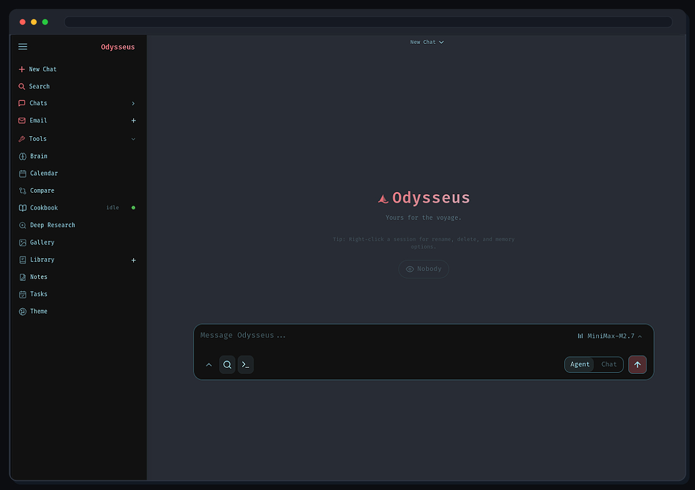
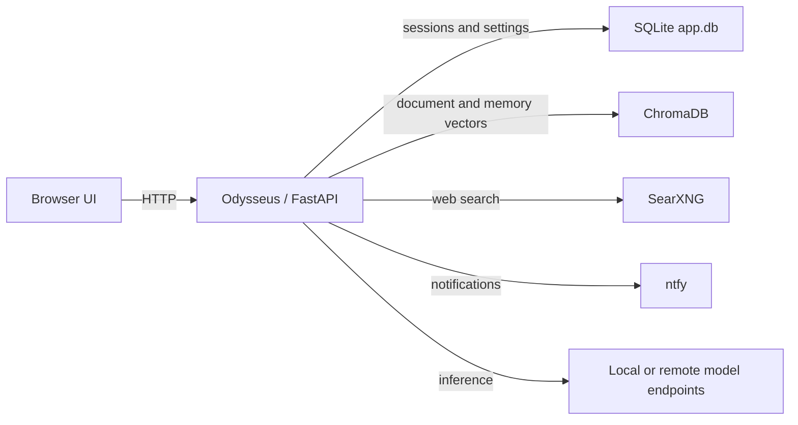
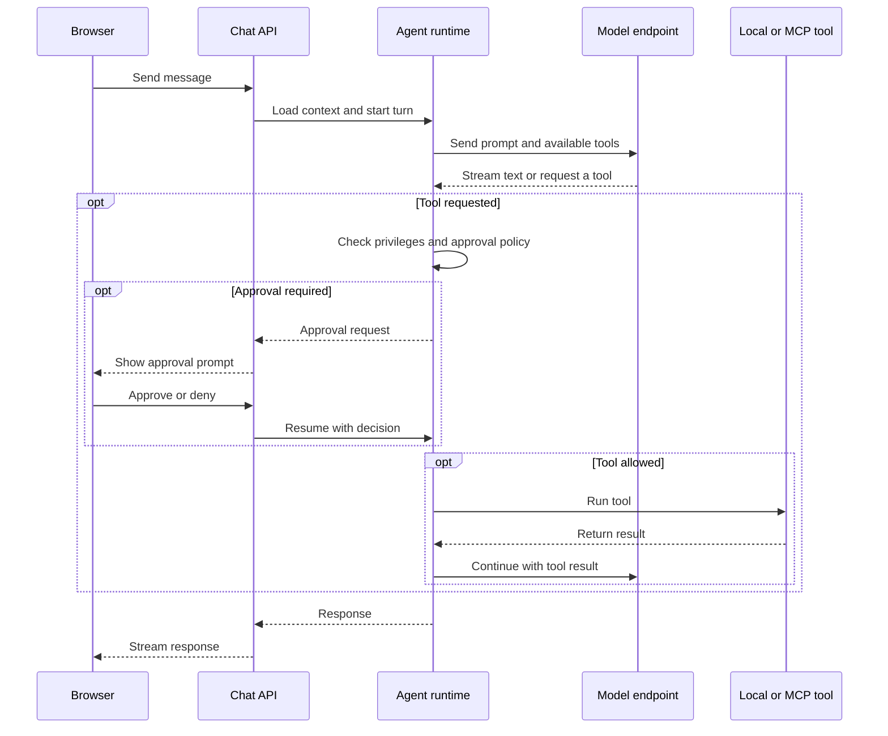

<p align="center">
  
</p>

<p align="center">
  A self-hosted AI workspace for chat, agents, research, documents, email, notes, calendar, and local model workflows.
</p>

<p align="center">
  <a href="#quick-start">Quick Start</a> ·
  <a href="website/setup.md">Setup Guide</a> ·
  <a href="CONTRIBUTING.md">Contributing</a> ·
  <a href="ROADMAP.md">Roadmap</a>
</p>

<p align="center">
  <a href="https://repology.org/project/odysseus-ai/versions"></a>
</p>

<p align="center">
  
</p>

---

## Quick Start

> `dev` is the default branch and gets the newest changes first. Use [`main`](https://github.com/odysseus-dev/odysseus/tree/main) if you want the more curated branch.

```bash
git clone https://github.com/odysseus-dev/odysseus.git
cd odysseus
cp .env.example .env
docker compose up -d
```

Open `http://localhost:7011` when the containers are healthy. The first admin password is printed in `docker compose logs odysseus`.

The compose files pull the official multi-arch image `ghcr.io/odysseus-dev/odysseus` (published by CI on every push to `main` and `dev`) and build locally if the pull fails. Use `docker compose up -d --build` when you specifically want to build the image from this checkout.

**Production deployments:** pin the immutable tag instead of `:latest`. `:latest` and bare `:X.Y.Z` tags move on every push to `main`, but `:X.Y.Z-<sha>` (e.g. `1.0.2-7c8070f`) always refers to one specific build:

```bash
ODYSSEUS_IMAGE=ghcr.io/odysseus-dev/odysseus:1.0.2-7c8070f docker compose up -d
```

Native installs, GPU notes, Windows/macOS instructions, HTTPS, and configuration live in the [setup guide](website/setup.md).

## Features and capabilities

- **Model access:** Connect local or remote model endpoints, including OpenAI-compatible APIs, Ollama, ChatGPT subscriptions, and Featherless. Switch models within the same workspace.
- **Chat and voice:** Keep persistent conversations, upload files, use web search, and speak or listen through configured speech providers.
- **Agents and tools:** Run agents with file, browser, shell, and MCP tools; extend them with skills, memory, plans, and scheduled tasks. Tool access is governed by user privileges and approval settings.
- **Model comparison:** Run blind side-by-side comparisons with voting and synthesis, or send one prompt to several models in a multi-model thread.
- **Local model Cookbook:** Get hardware-aware recommendations, download models, and manage local or remote serving endpoints.
- **Deep Research and knowledge:** Run multi-step web research with source reading and reports; search uploaded documents and use vector-backed memory and citations when configured.
- **Documents:** Write and revise in an editor with AI suggestions, Markdown and HTML support, CSV handling, and syntax highlighting.
- **Images and media:** Organize uploads in the gallery and edit images with layered controls and natural-language editing tools.
- **Email:** Connect IMAP/SMTP accounts for inbox triage, tags, summaries, reminders, reply drafting, and bulk export.
- **Notes, tasks, and calendar:** Capture notes and todos, schedule agent work, and sync calendar events through CalDAV.
- **Workspace administration:** Manage user permissions, sessions and sharing, API tokens, webhooks, and TOTP two-factor authentication.

## Architecture

- **Application:** [`app.py`](app.py) starts the FastAPI server. [`routes/`](routes/) contains HTTP endpoints, [`core/`](core/) holds persistence and session management, and [`src/`](src/) and [`services/`](services/) implement model, agent, and integration behavior.
- **Browser UI:** [`static/`](static/) contains the served HTML, CSS, JavaScript modules, and service worker. Modules maintained in [`frontend/src/`](frontend/src/) are copied to declared `static/js/` paths using [`frontend/modules.json`](frontend/modules.json); source and deployment files are committed together.
- **Compose services:** [`docker-compose.yml`](docker-compose.yml) starts Odysseus, ChromaDB for vector storage, SearXNG for search, and ntfy for notifications. The web UI binds to `127.0.0.1:7011` by default; change `APP_BIND` only when you intend to expose it through a trusted network or reverse proxy.
- **Persistent data:** The default database is SQLite at `./data/app.db`. Compose mounts `./data` and `./logs` into the app, with named volumes for ChromaDB, SearXNG, and ntfy. Keep these volumes when replacing containers or updating the image.

## Configuration and operations

Copy [`.env.example`](.env.example) to `.env` for deployment overrides. Common settings are `APP_BIND` and `APP_PORT` for the web listener, `AUTH_ENABLED` for sign-in, `DATABASE_URL` for the app database, `APP_DATA_DIR` and `APP_LOGS_DIR` for bind mounts, and `ODYSSEUS_IMAGE` for an immutable container image pin. Model endpoints and user-facing integrations can be configured in Settings. The [setup guide](website/setup.md) covers native installs, GPUs, HTTPS, and provider setup.

```bash
docker compose ps
docker compose logs --tail=120 odysseus
curl -fsS http://127.0.0.1:7011/api/ready
```

`/api/health` is a liveness check; `/api/ready` reports whether critical startup dependencies are ready and returns HTTP 503 when they are not.

## Development checks

Python 3.11+ is required for a native development install. Run the full pytest suite on Linux; some tests use POSIX-only APIs. The repository's test and frontend checks can be run from the root:

```bash
python -m compileall -q app.py core routes src services
python -m pytest -q
npm ci
node scripts/check_frontend.mjs
python scripts/build_frontend.py --check
docker compose config
```

The frontend publisher is a checked-in source-to-deployment copy step; run `python scripts/build_frontend.py` after changing a module owned by `frontend/src/`. See [CONTRIBUTING.md](CONTRIBUTING.md) for contribution workflow and focused checks.

## Demo

A full hover-to-play tour lives on the [Odysseus landing page](https://odysseus-dev.github.io/odysseus/). Its source lives under [`website/`](website/).

## Contributing

Help is welcome. The best entry points are fresh-install testing, provider setup bugs, mobile/editor polish, docs, and small focused refactors. See [CONTRIBUTING.md](CONTRIBUTING.md) and [ROADMAP.md](ROADMAP.md).

## Security

Odysseus is a self-hosted workspace with powerful local tools. Keep auth enabled, keep private data out of Git, and do not expose raw model/service ports publicly.

- Keep `AUTH_ENABLED=true` for any network-accessible deployment.
- Keep `LOCALHOST_BYPASS=false` outside local development.

Deployment details are in the [setup guide](website/setup.md#security-notes).

## How it works

### Deployment and data flow



The browser talks to the FastAPI app, which serves the UI and API. The default Compose setup keeps app data in SQLite and uses separate services for vector search, web search, and notifications. Connections to those services and model endpoints are used when the corresponding feature is configured or invoked.

### Chat and agent request



A chat turn loads the selected conversation context and calls its configured model. If the model requests a tool, Odysseus checks the user's permissions and may ask for approval before running it. The response streams back to the browser; conversation messages are persisted for later sessions.

## License

AGPL-3.0-or-later -- see [LICENSE](LICENSE) and [ACKNOWLEDGMENTS.md](ACKNOWLEDGMENTS.md).
